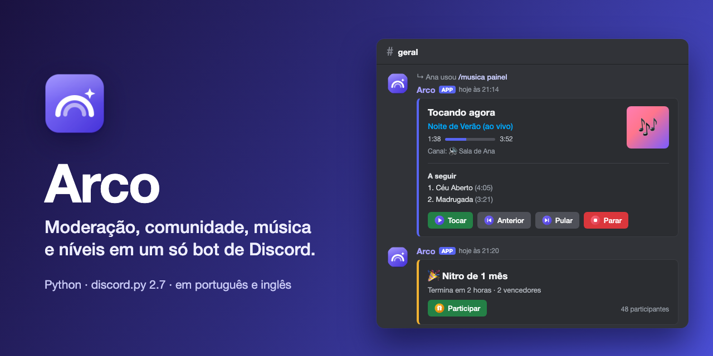

<p align="center">
  
</p>

<h1 align="center">Arco</h1>

<p align="center">
  Bot de Discord com moderação, comunidade, música e níveis.<br>
  Feito em Python com discord.py 2.7, em português e inglês.
</p>

<p align="center">
  
</p>

<p align="center">
  <a href="#comandos">Comandos</a> &nbsp;·&nbsp;
  <a href="#instalação">Instalação</a> &nbsp;·&nbsp;
  <a href="#manter-sempre-ligado">Sempre ligado</a> &nbsp;·&nbsp;
  <a href="#dados-e-backup">Dados e backup</a>
</p>

Só usa slash commands e menus de clique direito, e os painéis usam o layout novo do Discord (Components V2). As respostas privadas ("Só você pode ver isso") somem sozinhas: confirmações e avisos em 15 segundos, painéis e arquivos em 10 minutos. Os botões de painel (cargos, tickets, sorteios, sugestões, verificação, candidaturas, retribuir) continuam funcionando depois que o bot reinicia. Quem usa o Discord em inglês vê os comandos em inglês.

## Comandos

### Geral
| Comando | O que faz |
| --- | --- |
| `/ping` | Mostra se o bot está online e a latência |
| `/ajuda` | Lista os comandos que **você** pode usar, com um menu para escolher a categoria. Membros comuns não veem os comandos de moderação e administração; a equipe vê tudo, com 🔒 nos restritos |
| `/usuario [usuario]` | Cartão de perfil: datas de criação e entrada, cargos, banner |
| `/avatar [usuario]` | Avatar em tamanho grande (com o do servidor, se houver) e links para baixar |
| `/servidor` | Informações do servidor: dono, membros, canais, impulsos, banner |

### Moderação
| Comando | O que faz |
| --- | --- |
| `/mod silenciar` / `dessilenciar` | Castigo do Discord por 1 min a 28 dias |
| `/mod expulsar` | Expulsa e avisa a pessoa por DM |
| `/mod banir` | Bane (também por ID, mesmo de quem já saiu) e pode apagar mensagens recentes |
| `/mod desbanir` | Desbane, com a lista de banidos no autocomplete |
| `/mod advertir` | Registra uma advertência, avisa por DM e aplica a punição automática se atingir o limite |
| `/mod advertencias` | Histórico de advertências de alguém (ativas e expiradas) |
| `/mod perdoar` | Apaga as advertências de alguém |
| `/mod limpar` | Apaga até 200 mensagens, com filtro opcional por pessoa |
| `/mod lento` | Liga ou desliga o modo lento do canal |
| `/mod trancar` / `destrancar` | Impede ou libera mensagens de quem não tem cargo especial |
| `/mod raid` | Pausa ou libera convites e DMs entre membros (modo de segurança do Discord, até 24h) |
| `/logs` | Escolhe o canal que recebe os logs da moderação |
| `/automod` | Painel das regras nativas do AutoMod (palavrões, spam, spam de menções, palavras proibidas) |
| `/verificacao` | Painel com botão "Verificar" que dá o cargo de membro, com idade mínima de conta opcional |

O canal de `/logs` recebe:
- mensagens apagadas e editadas
- entradas e saídas do servidor e das calls
- banimentos, expulsões, castigos, mudanças de cargo e de apelido, com quem fez e o motivo (feitos pelo bot ou não)
- convites criados e alertas de possível raid
- advertências, denúncias, verificações recusadas e alertas do AutoMod
- a conversa completa de cada ticket fechado

**Anti-raid:** com `/configurar antiraid`, o bot avisa nos logs quando muita gente entra em poucos segundos e, se você quiser, pausa convites e DMs por 1 hora sozinho.

Hierarquia: ninguém consegue moderar alguém com cargo igual ou acima do seu (ou do bot), nem o dono do servidor.

### Comunidade
| Comando | O que faz |
| --- | --- |
| `/enquete` | Enquete nativa do Discord. Quando acaba, o bot publica o resultado com barras e o vencedor |
| `/sugerir` | Sugestão com votos 👍/👎. A equipe aprova ou recusa com resposta, e o autor recebe por DM. Funciona em canal de texto (com thread para discutir) ou em fórum (com etiqueta de status) |
| `/sorteio criar` / `encerrar` / `ressortear` | Sorteio com botão de participar, vários ganhadores, cargo obrigatório opcional e encerramento automático |
| `/anuncio criar` / `agendados` / `cancelar` | Anúncio no layout novo, com imagem, botão com link, cor e menção a um cargo; na hora ou agendado |
| `/cargos` | Painel com até 20 botões: clica para pegar o cargo, clica de novo para largar |
| `/tickets` | Thread privada com a equipe, com botões para fechar e baixar a conversa. Ao fechar, a conversa vai para os logs e para quem abriu |
| `/candidaturas` | Formulário (área, motivo, disponibilidade, até 3 arquivos, aceite das regras). A equipe aprova ou recusa; quem for aprovado pode ganhar um cargo |
| `/evento` | Cria um evento agendado (em canal de voz/palco ou externo), com capa opcional |
| `/lembrete criar` / `listar` / `cancelar` | Lembrete por tempo (`10m`, `1h30m`) ou data (`25/12 20:00`, `amanha 9h`) |
| `/aniversario definir` / `remover` / `proximos` | Aniversários do servidor, com parabéns às 9h e cargo de aniversariante do dia |

**Eventos:** com `/configurar eventos`, o bot avisa num canal alguns minutos antes de cada evento começar, e quem marca "Tenho interesse" ganha um cargo que sai quando o evento acaba.

### Voz e música
| Comando | O que faz |
| --- | --- |
| `/musica tocar` | Toca ou põe na fila (link do YouTube ou busca, com sugestões do YouTube enquanto você digita) |
| `/musica pular` / `anterior` / `parar` | Controles da reprodução |
| `/musica fila` / `limpar` | Ver ou limpar a fila |
| `/musica painel` | Painel "tocando agora" com capa, barra de progresso, próximas da fila e todos os controles em botões |
| `/som tocar` | Toca um som do soundboard (do servidor ou padrão do Discord) na sua call |
| `/sala renomear` / `limite` / `trancar` / `destrancar` / `expulsar` / `transferir` | Controles da sua sala de voz temporária |
| `/palco abrir` / `fechar` / `palestrante` / `plateia` | Abre um palco com tema e organiza quem fala |

A fila de música é salva: se o bot reiniciar e ainda tiver gente na call, ele volta e continua tocando. O bot sai sozinho da call depois de 5 minutos sem tocar nada.

Salas temporárias: quem entra no canal configurado em `/configurar salas` ganha uma sala própria, que é apagada quando fica vazia.

### Níveis e jogos
| Comando | O que faz |
| --- | --- |
| `/xp` | Menu com seu rank, o ranking do servidor, como funciona e as configurações (admin) |
| `/interagir` | 25 interações com gif de anime (abraçar, beijar, cafuné, toca aqui, guerra de travesseiro…). Quem recebe pode clicar em **Retribuir** |
| `/gif` | Busca um gif no Giphy |

XP:
- Mensagens dão de 15 a 25 XP (no máximo uma vez a cada 20 s).
- Ficar em call com pelo menos mais uma pessoa dá 5 XP por minuto. Não conta quem está com o fone desligado nem no canal AFK.
- Quem tem Gerenciar Servidor pode ligar ou desligar o sistema, zerar o XP do servidor, dar ou tirar XP e configurar cargos automáticos por nível.

Também tem o **jogo de contagem** (cada pessoa manda o próximo número; errou, recomeça do 1, e o bot guarda o recorde) e o **mural de destaques** (mensagens que juntam X reações ⭐ vão para um canal).

### Servidor
| Comando | O que faz |
| --- | --- |
| `/configurar ver` | Mostra tudo o que está ligado no servidor |
| `/configurar sugestoes` | Canal (texto ou fórum) das sugestões |
| `/configurar aniversarios` | Canal dos parabéns e cargo de aniversariante |
| `/configurar destaques` | Canal do mural, quantidade mínima e emoji |
| `/configurar contagem` | Canal do jogo de contagem |
| `/configurar salas` | Canal de voz que cria as salas temporárias |
| `/configurar advertencias` | Limite de advertências, punição automática (silenciar, expulsar ou banir) e validade |
| `/configurar antiraid` | Quantas entradas em quantos segundos disparam o alerta, e se pausa sozinho |
| `/configurar eventos` | Canal e antecedência do aviso de evento, e cargo de interessados |
| `/configurar auto_thread` | Cria uma thread em cada mensagem nova de um canal (bom para arte, dúvidas, divulgação) |
| `/configurar xp_voz` | Liga ou desliga o XP em call |
| `/configurar tela_boas_vindas` | Tela de boas-vindas do Discord, com até 3 canais recomendados (servidores da Comunidade) |
| `/configurar integracao_pergunta` | Adiciona uma pergunta de cargos à integração inicial do Discord (servidores da Comunidade) |
| `/boasvindas` | Canal e texto de boas-vindas para novos membros |
| `/emoji adicionar` / `copiar` / `figurinha` / `som` | Cria emoji a partir de imagem, copia emoji de outro servidor, cria figurinha ou adiciona um som ao soundboard |
| `/cargo_visual` | Muda cor (com degradê), ícone ou emoji de um cargo, nos servidores que têm esses recursos |

Para desligar um recurso, use o `/configurar` dele sem escolher canal.

### Menus de clique direito (Apps)
- **Em uma pessoa:** Ver perfil, Ver avatar, Ver rank XP
- **Em uma mensagem:** Denunciar mensagem (vai para o canal de logs), Fixar ou desafixar, Adicionar emojis ao servidor (copia os emojis personalizados da mensagem)

`/ping`, `/ajuda`, `/usuario`, `/avatar`, `/gif`, `/enquete`, `/lembrete` e os menus Ver perfil e Ver avatar também funcionam em DM e se o bot for instalado na sua conta ("Adicionar aos meus apps").

### Limite de uso
Para evitar spam, alguns comandos têm um limite por pessoa: `/gif` e `/interagir` (3 a cada 30 s), `/enquete` e `/sorteio criar` (1 a cada 30 s), `/sugerir` (1 a cada 2 min) e `/lembrete criar` (5 por minuto).

## Instalação

Requer Python 3.10 ou mais novo e o `ffmpeg` no PATH (para música).

```bash
python3 -m venv venv
venv/bin/pip install -r requirements.txt
```

Crie um `.env` na raiz:

```
DISCORD_TOKEN=token-do-bot
GIPHY_API_KEY=chave-da-api-do-giphy
# Opcional, padrão America/Sao_Paulo - fuso das datas digitadas, dos parabéns e do backup
FUSO_HORARIO=America/Sao_Paulo
```

No [Developer Portal](https://discord.com/developers/applications), em **Bot > Privileged Gateway Intents**, ligue **Server Members Intent** e **Message Content Intent**. Sem isso o bot não conecta.

Para convidar o bot com todas as permissões que ele usa:

```
https://discord.com/oauth2/authorize?client_id=SEU_CLIENT_ID&scope=bot+applications.commands&permissions=67474229161206
```

O cargo do bot precisa ficar **acima** dos cargos que ele vai dar (cargos por nível, painel de cargos, verificação, aniversário, candidatura, interessados em evento) e das pessoas que ele vai moderar.

Para rodar:

```bash
venv/bin/python main.py
```

Na primeira vez, o bot envia os próprios emojis (os ícones dos botões de música, sorteio e verificação) para a aplicação no Discord. Eles não ocupam espaço de emoji dos servidores.

## Manter sempre ligado

No Mac, o script abaixo cria um serviço do launchd que liga o bot junto com o login e o reinicia se ele cair:

```bash
scripts/servico.sh instalar
```

Os outros comandos do script são `status`, `reiniciar`, `logs` (acompanha o log ao vivo) e `remover`.

Os logs ficam em `logs/bot.log`, que gira em 5 arquivos de 5 MB.

## Permissões dos comandos

Os comandos de administração já vêm escondidos para quem não tem a permissão correspondente:

| Permissão | Comandos |
| --- | --- |
| Moderar Membros | `/mod` |
| Gerenciar Servidor | `/logs`, `/automod`, `/boasvindas`, `/tickets`, `/candidaturas`, `/sorteio`, `/anuncio`, `/configurar` |
| Gerenciar Cargos | `/cargos`, `/verificacao`, `/cargo_visual` |
| Gerenciar Canais | `/palco` |
| Gerenciar Eventos | `/evento` |
| Criar Expressões | `/emoji`, menu Adicionar emojis ao servidor |

Para mudar quem vê cada um, use **Configurações do servidor > Integrações > Arco**. Cada subcomando de `/mod` ainda confere a permissão específica dele (por exemplo, Banir Membros no `/mod banir`).

Cargos com permissões de moderação ou administração nunca são entregues por botão (painel de cargos, verificação, candidatura aprovada).

## Dados e backup

Tudo fica em `data/` (fora do git):

| Arquivo | O que guarda |
| --- | --- |
| `xp.db` | XP e cargos por nível |
| `moderacao.db` | Advertências e canal de logs |
| `comunidade.db` | Lembretes |
| `bot.db` | Sorteios, sugestões, aniversários, mural, contagem, salas, candidaturas, anúncios agendados, enquetes e o `/configurar` |
| `musica_fila.json` | Fila de música |
| `anuncios/` | Imagens dos anúncios agendados |

A configuração de boas-vindas fica em `boas_vindas.json`. As regras do AutoMod ficam no próprio Discord, com o prefixo `[Bot]`.

Todo dia às 4h o bot faz um backup em `backups/backup-AAAA-MM-DD.zip` e guarda os 7 mais recentes. Os bancos são copiados de um jeito seguro mesmo com o bot rodando. Para restaurar, desligue o bot e descompacte o zip na raiz do projeto:

```bash
unzip -o backups/backup-2026-10-19.zip
```

## Imagens

O ícone, a capa e os emojis do bot são gerados a partir dos HTML em `design/` (precisa do Google Chrome):

```bash
scripts/gerar_imagens.sh
```

## Testes

```bash
venv/bin/pip install -r requirements-dev.txt
venv/bin/pytest
```

Além das funções puras e dos bancos de cada recurso, os testes carregam o bot inteiro sem conectar e serializam todos os comandos, painéis e formulários. Também conferem que todo comando tem tradução e aparece no `/ajuda`. Isso pega nome inválido, limite de componentes e erro de import antes de subir o bot de verdade.
